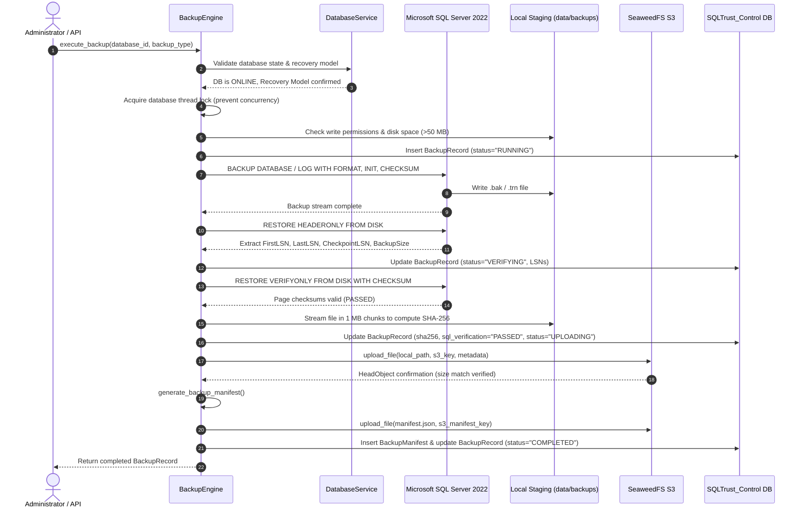

# SQL-TRUST — Backup Workflow & Verification Lifecycle

This document describes the step-by-step lifecycle of a backup execution in SQL-TRUST Module 1.

---

## 1. End-to-End Workflow Diagram



---

## 2. Recovery Model Requirements & Enforcement

| Backup Type | Supported Recovery Models | Chain Preconditions | Rationale |
| :--- | :--- | :--- | :--- |
| **FULL** | `SIMPLE`, `FULL`, `BULK_LOGGED` | None | Establishes the initial baseline for all future differentials and log backups. |
| **DIFFERENTIAL** | `SIMPLE`, `FULL`, `BULK_LOGGED` | Prior completed `FULL` backup | Captures extent changes since the last full baseline. |
| **TRANSACTION LOG** | `FULL`, `BULK_LOGGED` only | Prior completed `FULL` backup | **SIMPLE model blocked:** In SIMPLE recovery, SQL Server automatically truncates inactive log extents during checkpoints. Taking log backups would disrupt recovery chains and is prohibited by the database engine. |

---

## 3. Two-Stage Integrity Verification

### Stage 1: SQL Server Backup Verification
- **Command:** `RESTORE VERIFYONLY FROM DISK = N'{path}' WITH CHECKSUM;`
- **Scope:** Verifies that the backup file is complete, readable by SQL Server, and that all page-level checksums embedded during backup are valid.
- *Caveat:* `RESTORE VERIFYONLY` confirms the physical integrity of the backup media, but does not prove the absence of application-level data corruption or malicious tampering.

### Stage 2: Cryptographic Hash Verification
- **Method:** 1 MB chunked stream using `hashlib.sha256()`.
- **Purpose:** Produces an immutable cryptographic fingerprint of the backup artifact.
- **Protection:** During on-demand re-verification, the hash is recomputed and compared against the original stored value to detect bit-rot or offline file tampering.

---

## 4. State Transitions & Failure Resilience

A backup operation transitions through strict states:

```
PENDING  ──>  RUNNING  ──>  VERIFYING  ──>  UPLOADING  ──>  COMPLETED
   │             │              │              │
   └───► FAILED ◄┴──────────────┴──────────────┘
```

- If an error occurs at any point (e.g., checksum error, S3 network timeout, disk full), the operation transitions immediately to `FAILED`.
- The exact error stack is preserved in `BackupRecord.error_message` and `BackupOperationLog`.
- Partial or corrupt files are never uploaded to remote storage.
